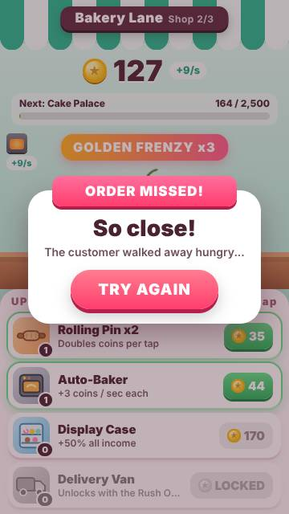
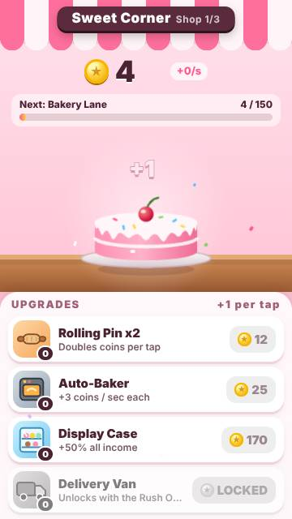

# Friction report — Bakery Rush

The core tap-to-bake and upgrade loop was clear, allowing the player to progress from Sweet Corner to Bakery Lane. However, a slow initial start, a small target for the Golden Cupcake, and an overly demanding Rush Order target caused repeated failures.

| time | type | severity | issue | suggested fix |
| --- | --- | --- | --- | --- |
| 0:31.4–0:41.8 | frustration | high | **Rush Order target (25 cakes in 10s) is too difficult** — The player activated Golden Frenzy x3 but only reached 11/25 cakes before the 'ORDER MISSED!' fail screen appeared at t=31.4s. After tapping 'Try Again', they only reached 12/25 cakes with 1s left at t=41.8s. | Reduce the Rush Order requirement from 25 cakes to 12-15 cakes in 10s (or extend the timer to 15s) so casual players can complete the order and experience the reward. |
| 0:00.0–0:05.4 | pacing | medium | **Slow time to first tap due to lack of initial motion** — Despite the 'Tap the cake to bake!' tutorial, there was 3.5s of idle time with no on-screen motion, and it took 5.4s for the first tap to register. | Add an animated, pulsing hand pointer directly over the center cake from t=0.0s along with a subtle idle bounce on the cake to prompt immediate interaction. |
| 0:25.9 | ui | low | **Imprecise taps when trying to hit the Golden Cupcake** — Two imprecise tap slips were recorded at t=25.9s, right as the player was trying to activate the floating Golden Cupcake x3. | Increase the invisible hit-box of the floating Golden Cupcake by 30-50% and slow its travel speed slightly so it is easier to tap during active gameplay. |

## Evidence

**0:31.4 · Rush Order target (25 cakes in 10s) is too difficult** (signals S3)

**0:00.0 · Slow time to first tap due to lack of initial motion** (signals S1, S2)

## Signals extracted from the session

- `S1` 0:00.0 [time_to_first_success] 5.4 s from the first playable frame until an input visibly worked
- `S2` 0:00.0 [idle] 3.5 s with no on-screen motion and no input
- `S3` 0:31.4 [fail_screen] a fail / game-over screen
- `S4` 0:25.9 [slips] 2 imprecise tap(s) by the player (targets may be small)
- `S5` 0:44.2 [end_card] end card appeared at 44.2 s (session 49.1 s)
