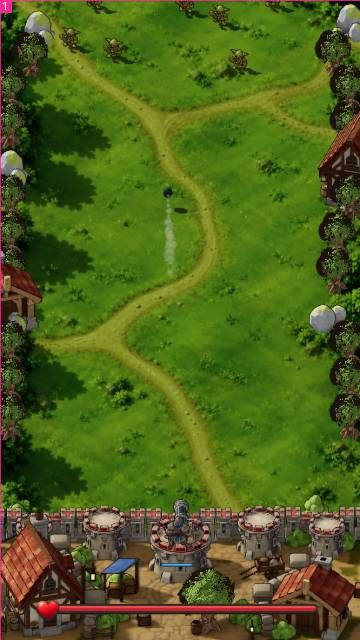
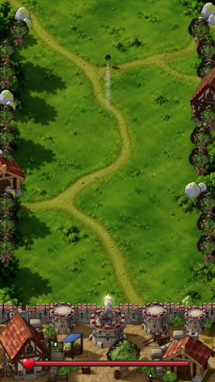
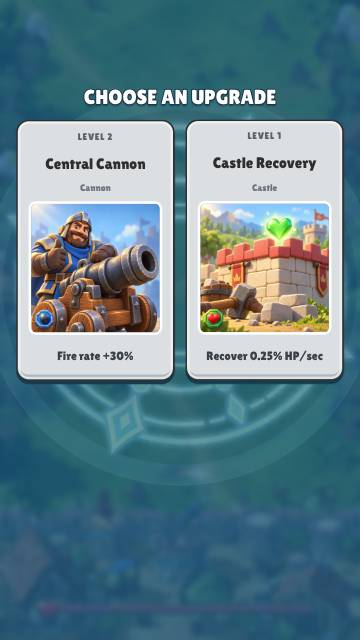

# Friction report — Boom Castle TD

The player understood the core drag-to-aim cannon mechanic and recruited the Fire Mage, but experienced a slow, empty opening and persistent uncertainty about where and how to aim during waves. The session also lacked an end card after 71 seconds and had an upgrade popup interrupt active aiming.

| time | type | severity | issue | suggested fix |
| --- | --- | --- | --- | --- |
| 0:08.3–1:06.9 | confusion | high | **No persistent aiming cue after initial tutorial** — Although a 'DRAG TO AIM' tutorial appeared at t=2.0s, once gameplay began the screen had no aiming reticle, trajectory preview, or pull-ring on the central cannon, leading to low confidence (21%-40%) across 15 gameplay checks. | Add a subtle pulsing drag-ring around the central cannon when idle and show a dotted trajectory arc while dragging so players always know where to touch and where the shot will land. |
| 0:00.0–0:08.5 | pacing | high | **Slow opening with empty battlefield** — It took 5.3s for the first input to visibly work, and two idle gaps occurred (0.5-3.5s and 4.5-8.5s) because goblins did not spawn until t=8.3s, leaving the player firing at an empty path. | Spawn the first wave of goblins and a red explosive barrel immediately at t=0.0s so the player's very first drag-to-aim shot hits a target right away. |
| 1:11.3 | pacing | medium | **No end card shown within 71 seconds** — The session ran until the 71.3s time limit without ever presenting an end card or install CTA. | Trigger the end card with a clear 'Play Now / Install' CTA after the second upgrade wave or around 35-45 seconds of play. |
| 0:47.0 | ui | medium | **Upgrade popup interrupts active aiming** — At t=47.0s, the upgrade selection popup ('Central Cannon' and 'Castle Recovery') appeared mid-action while the player was aiming at approaching goblins, causing their input to have no visible effect. | Add a brief 0.5s input-lock grace period when the upgrade popup opens so stray gameplay drags do not get eaten or accidentally misclick an upgrade card. |

## Evidence

**0:08.3 · No persistent aiming cue after initial tutorial** (signals S2, S3, S4, S5, S6, S7, S8, S9, S10, S11, S12, S13, S14, S15, S16)

**0:00.0 · Slow opening with empty battlefield** (signals S1, S18, S19)

**0:47.0 · Upgrade popup interrupts active aiming** (signals S17)

## Signals extracted from the session

- `S1` 0:00.0 [time_to_first_success] 5.3 s from the first playable frame until an input visibly worked
- `S2` 0:08.3 [unclear_screen] decider: only 21% that a first-time player knows what to do (screen: gameplay)
- `S3` 0:11.5 [unclear_screen] decider: only 24% that a first-time player knows what to do (screen: gameplay)
- `S4` 0:14.0 [unclear_screen] decider: only 33% that a first-time player knows what to do (screen: gameplay)
- `S5` 0:17.9 [unclear_screen] decider: only 40% that a first-time player knows what to do (screen: gameplay)
- `S6` 0:28.0 [unclear_screen] decider: only 31% that a first-time player knows what to do (screen: gameplay)
- `S7` 0:30.8 [unclear_screen] decider: only 29% that a first-time player knows what to do (screen: gameplay)
- `S8` 0:34.4 [unclear_screen] decider: only 25% that a first-time player knows what to do (screen: gameplay)
- `S9` 0:37.3 [unclear_screen] decider: only 33% that a first-time player knows what to do (screen: gameplay)
- `S10` 0:40.4 [unclear_screen] decider: only 32% that a first-time player knows what to do (screen: gameplay)
- `S11` 0:43.4 [unclear_screen] decider: only 25% that a first-time player knows what to do (screen: gameplay)
- `S12` 0:52.7 [unclear_screen] decider: only 33% that a first-time player knows what to do (screen: gameplay)
- `S13` 0:55.7 [unclear_screen] decider: only 35% that a first-time player knows what to do (screen: gameplay)
- `S14` 0:59.3 [unclear_screen] decider: only 28% that a first-time player knows what to do (screen: gameplay)
- `S15` 1:03.4 [unclear_screen] decider: only 37% that a first-time player knows what to do (screen: gameplay)
- `S16` 1:06.9 [unclear_screen] decider: only 25% that a first-time player knows what to do (screen: gameplay)
- `S17` 0:47.0 [no_effect] previous input had no visible effect (decider 24%, 60.3% of pixels changed) — the player had tried: Gameplay with goblins approaching the wall from multiple paths; Fire Mage is sho
- `S18` 0:00.5 [idle] 3.0 s with no on-screen motion and no input
- `S19` 0:04.5 [idle] 4.0 s with no on-screen motion and no input
- `S20` 1:11.3 [no_end_card] no end card within 71 s of play
