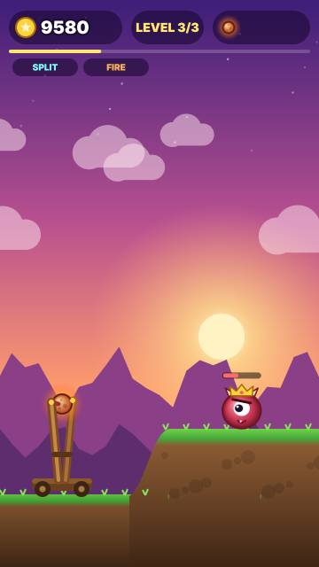
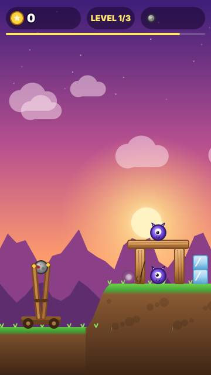
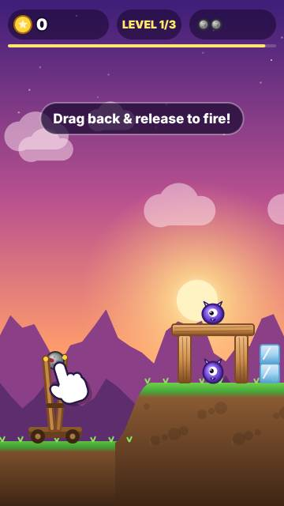

# Friction report — Castle Toss

The first-time experience was smooth and engaging, with the player completing all three levels and reaching the end card in 42.5 seconds. Minor friction occurred around aiming clarity after the tutorial disappeared and feedback during the final boss encounter.

| time | type | severity | issue | suggested fix |
| --- | --- | --- | --- | --- |
| 0:34.7 | unclear_goal | medium | **Low visual feedback and unclear Split Shot cue on final boss** — At t=34.7s, the crowned red boss remained alone with low HP and 1 boulder left; the previous shot produced only 3.0% pixel change (no_effect) and the screen clarity dropped to 27% while 'SPLIT' and 'FIRE' badges sat passively at the top-left. | Add a brief hit-flash or floating damage number when the boss takes damage, and display a subtle 'Tap mid-air to Split!' hint while a Split Shot boulder is in flight. |
| 0:06.3 | confusion | low | **No aiming cue after the first-shot tutorial disappears** — After the first shot missed or failed to clear the wooden structure at t=6.3s, the 'Drag back & release to fire!' banner and hand pointer were gone, leaving screen clarity at 50% with a new boulder loaded. | Pulse the loaded boulder gently in the slingshot and show a faint dotted trajectory arc as soon as the player touches the slingshot. |
| 0:00.0–0:02.0 | pacing | low | **Fast initial onboarding with minor room for drag-direction clarity** — The player took 2.0s from the first playable frame to execute a working shot using the 'Drag back & release to fire!' banner and hand pointer. | Animate the hand pointer slightly backward along the pull vector on frame 0 so players immediately see the drag direction. |

## Evidence

**0:34.7 · Low visual feedback and unclear Split Shot cue on final boss** (signals S3, S4)

**0:06.3 · No aiming cue after the first-shot tutorial disappears** (signals S2)

**0:00.0 · Fast initial onboarding with minor room for drag-direction clarity** (signals S1)

## Signals extracted from the session

- `S1` 0:00.0 [time_to_first_success] 2.0 s from the first playable frame until an input visibly worked
- `S2` 0:06.3 [unclear_screen] decider: only 50% that a first-time player knows what to do (screen: gameplay)
- `S3` 0:34.7 [unclear_screen] decider: only 27% that a first-time player knows what to do (screen: gameplay)
- `S4` 0:34.7 [no_effect] previous input had no visible effect (decider 17%, 3.0% of pixels changed) — the player had tried: Level 3/3 gameplay, only the crowned red boss remains with ~35% HP
- `S5` 0:42.5 [end_card] end card appeared at 42.5 s (session 47.3 s)
