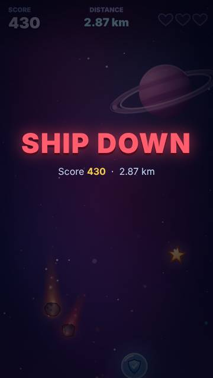
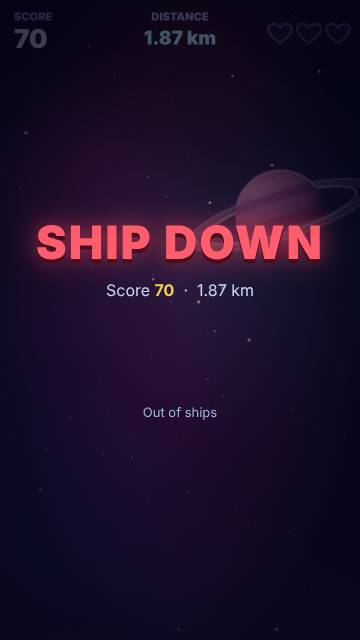

# Friction report — Comet Dodge

The first-time player understood the controls quickly and enjoyed a smooth two-run session through Comet Walls, Zig-Zag comets, and Double Walls. The main friction points were multi-second delays on both 'SHIP DOWN' fail screens before any button or end card appeared.

| time | type | severity | issue | suggested fix |
| --- | --- | --- | --- | --- |
| 0:29.5–0:32.5 | ui | medium | **3-second delay before 'TRY AGAIN' button appears** — At t=29.5s, the 'SHIP DOWN' screen appeared with Score 430 and 2.87 km, but no button was visible (S2, S7), resulting in 31% clarity and an ineffective input (S4). The 'TRY AGAIN' button did not appear until t=32.5s (S8). | Show the 'TRY AGAIN' button immediately when the 'SHIP DOWN' screen appears (or within 0.5s) so players know right away how to start their second ship. |
| 0:48.5–0:51.0 | pacing | medium | **Dead-end 'Out of ships' screen before end card** — After the second ship was destroyed at t=48.5s, the 'SHIP DOWN' screen displayed 'Out of ships' with no button or transition cue (S3, S9), yielding 22% clarity and contributing to a 4.5s idle gap (S6) before the end card appeared at t=51.0s (S10). | Transition directly from the final ship explosion to the end card, or add a brief animated 'FINAL SCORE...' transition indicator on the 'Out of ships' screen. |
| 0:49.5–0:54.0 | boredom | low | **Static end card with no idle motion** — Between the 'Out of ships' screen and the end card at t=51.0s (S10), the session recorded 4.5s with no on-screen motion or input (S6). | Add a subtle pulsing animation to the 'PLAY NOW' button and keep background stars drifting on the end card to draw attention to the CTA. |

## Evidence

**0:29.5 · 3-second delay before 'TRY AGAIN' button appears** (signals S2, S4, S7, S8)

**0:48.5 · Dead-end 'Out of ships' screen before end card** (signals S3, S6, S9, S10)

## Signals extracted from the session

- `S1` 0:00.0 [time_to_first_success] 2.0 s from the first playable frame until an input visibly worked
- `S2` 0:29.5 [unclear_screen] decider: only 31% that a first-time player knows what to do (screen: fail)
- `S3` 0:48.5 [unclear_screen] decider: only 22% that a first-time player knows what to do (screen: fail)
- `S4` 0:29.5 [no_effect] previous input had no visible effect (decider 8%, 35.0% of pixels changed) — the player had tried: Rocket at x=730, SHIELD at x=650, star at x=790, SPLIT ROCKS banner
- `S5` 0:38.1 [no_effect] previous input had no visible effect (decider 26%, 17.0% of pixels changed) — the player had tried: Rocket at x=215, SHIELD power-up ahead at x=500, comets falling
- `S6` 0:49.5 [idle] 4.5 s with no on-screen motion and no input
- `S7` 0:29.5 [fail_screen] a fail / game-over screen
- `S8` 0:32.5 [fail_screen] a fail / game-over screen
- `S9` 0:48.5 [fail_screen] a fail / game-over screen
- `S10` 0:51.0 [end_card] end card appeared at 51.0 s (session 56.0 s)
