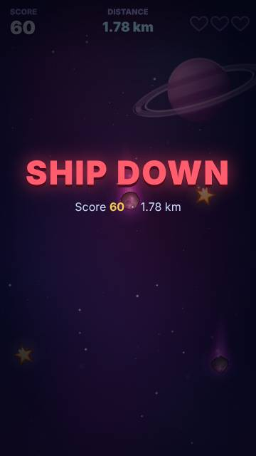
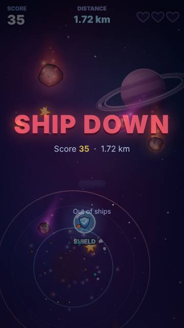
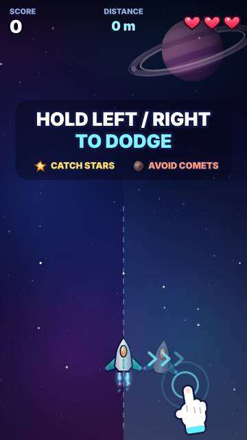

# Friction report — Comet Dodge

The first-time experience is smooth overall, with clear controls and engaging progression through Comet Walls and Zig-Zag comets. The main friction is a ~2.2-second delay on both 'SHIP DOWN' fail screens before the 'TRY AGAIN' button or end card appears, leaving players with no clear action and unresponsive inputs.

| time | type | severity | issue | suggested fix |
| --- | --- | --- | --- | --- |
| 0:21.7–0:23.9 | ui | medium | **Delayed 'TRY AGAIN' button on first fail screen** — At t=21.7s, the 'SHIP DOWN' screen appeared with 'Score 60 · 1.78 km' but no button, causing the player's input to have no effect (S4) and only 23% clarity on what to do (S2) until 'TRY AGAIN' finally appeared at t=23.9s. | Show the 'TRY AGAIN' button immediately when the 'SHIP DOWN' screen appears, or add a brief, visible countdown/transition indicator so players know not to tap yet. |
| 0:39.3–0:41.5 | ui | medium | **Dead-air delay before end card on final fail screen** — At t=39.3s, the 'SHIP DOWN' screen showed 'Out of ships' with no CTA, resulting in 26% clarity (S3) and an unresponsive input (S5) for 2.2 seconds until the end card appeared at t=41.5s. | Transition directly to the end card or display a 'Loading...' / 'Final Score' progress indicator immediately on the 'Out of ships' screen. |
| 0:00.0–0:02.0 | pacing | low | **Brief 2-second delay before first input registers** — It took 2.0s from the first playable frame (tutorial overlay showing 'HOLD LEFT / RIGHT TO DODGE' and a hand pointing right) until an input visibly moved the rocket. | Allow the player's first touch-and-hold to immediately dismiss the tutorial overlay and steer the rocket without any initial lock-out. |

## Evidence

**0:21.7 · Delayed 'TRY AGAIN' button on first fail screen** (signals S2, S4, S6, S7)

**0:39.3 · Dead-air delay before end card on final fail screen** (signals S3, S5, S8, S9)

**0:00.0 · Brief 2-second delay before first input registers** (signals S1)

## Signals extracted from the session

- `S1` 0:00.0 [time_to_first_success] 2.0 s from the first playable frame until an input visibly worked
- `S2` 0:21.7 [unclear_screen] decider: only 23% that a first-time player knows what to do (screen: fail)
- `S3` 0:39.3 [unclear_screen] decider: only 26% that a first-time player knows what to do (screen: fail)
- `S4` 0:21.7 [no_effect] previous input had no visible effect (decider 7%, 39.5% of pixels changed) — the player had tried: ZIG-ZAG! banner, rocket centered below a star, comet walls on sides
- `S5` 0:39.3 [no_effect] previous input had no visible effect (decider 18%, 20.4% of pixels changed) — the player had tried: Space dodger gameplay, 1 heart left, shield power-up and asteroids incoming
- `S6` 0:21.7 [fail_screen] a fail / game-over screen
- `S7` 0:23.9 [fail_screen] a fail / game-over screen
- `S8` 0:39.3 [fail_screen] a fail / game-over screen
- `S9` 0:41.5 [end_card] end card appeared at 41.5 s (session 46.2 s)
