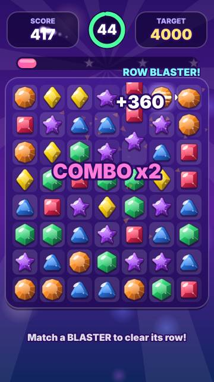
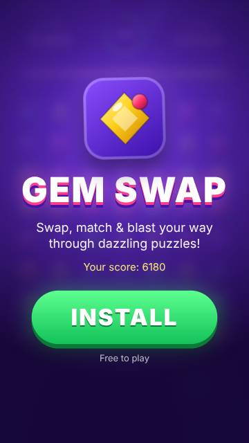

# Friction report — Gem Swap

The first-time experience was smooth and engaging, with the player quickly understanding the match-3 mechanics, triggering combos and Fever Time, and surpassing the 4000-point target. The only minor friction came from a slightly slow 5.1-second start to the first successful match and an abrupt transition to the end card while the player was still swiping.

| time | type | severity | issue | suggested fix |
| --- | --- | --- | --- | --- |
| 0:00.0–0:05.1 | pacing | low | **Slightly slow time to first successful match** — It took 5.1 seconds from the first playable frame for the player's first swipe to visibly succeed (S1), even though the tutorial hand was already visible at 2.0 seconds. | Allow the player's swipe input to register immediately as soon as the board appears, rather than waiting for an intro or tutorial hand animation to finish. |
| 0:19.0–0:20.3 | ui | low | **Abrupt end-card transition interrupts active swiping** — The end card appeared at 19.0 seconds while the timer still showed 36 seconds remaining at 17.5 seconds (S3), causing the player's ongoing gameplay swipe to have no visible effect at 20.3 seconds (S2). | Lock board input cleanly and display a brief 1-second 'Round Complete' or 'Bonus Blast Complete' transition before fading in the end card so active swipes are not cut off mid-gesture. |
| 0:19.0 | pacing | low | **Early end-card trigger before timer expires** — The round ended and showed the end card at 19.0 seconds (S3) with 36 seconds still left on the 45-second timer, which may feel premature to players enjoying Fever Time. | If ending the playable early after 'Target Smashed!' is intentional, add a clear 'Bonus Time Complete!' message on the transition so players understand why the round ended with time left on the clock. |

## Evidence

**0:00.0 · Slightly slow time to first successful match** (signals S1)

**0:19.0 · Abrupt end-card transition interrupts active swiping** (signals S2, S3)

## Signals extracted from the session

- `S1` 0:00.0 [time_to_first_success] 5.1 s from the first playable frame until an input visibly worked
- `S2` 0:20.3 [no_effect] previous input had no visible effect (decider 2%, 58.6% of pixels changed) — the player had tried: Match-3 gameplay, score 6180, timer 36s, FEVER x2 bar
- `S3` 0:19.0 [end_card] end card appeared at 19.0 s (session 25.4 s)
