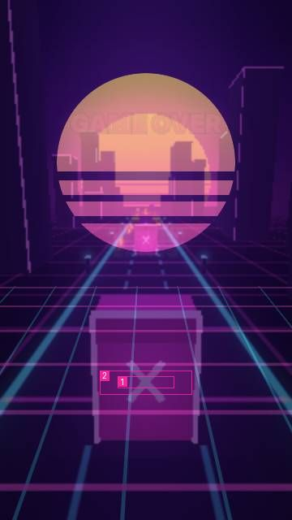
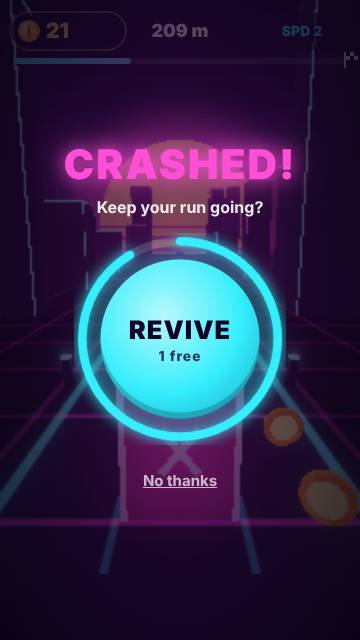

# Friction report — Neon Lanes

The first-time experience is mostly smooth with clear lane-switching and jumping tutorials, but high-speed crashes feel unresponsive when late swipes fail to register. Additionally, the Game Over end card fades in with low-contrast text and no immediately visible call-to-action, leaving the player briefly unsure of what to do.

| time | type | severity | issue | suggested fix |
| --- | --- | --- | --- | --- |
| 0:23.4 | ui | high | **Low-contrast Game Over screen with missing initial CTA** — At t=23.4s, the end card appeared (S7) but the decider rated only 32% confidence that a first-time player knows what to do (S2). In the screenshot, 'GAME OVER' is very faint inside the sun and no 'Play now' button is visible yet. | Increase the contrast and opacity of the 'GAME OVER' header on the end card, and display the 'Play now' CTA button immediately without a fade-in delay. |
| 0:15.7–0:23.4 | frustration | medium | **Late swipes fail to register before high-speed collisions** — At t=15.7s (S3, S5) and t=23.4s (S4), the player's swipe input had no visible effect right before crashing into a pink block, particularly at high speed (SPD 81 at 273m). | Add input buffering and slightly faster lane-switch interpolation at higher speeds (SPD 60+) so late-frame dodges still register cleanly. |
| 0:00.0–0:02.0 | pacing | low | **2.0s delay before first swipe visibly works** — From t=0.0s to t=2.0s (S1), it took 2.0s for the player's first input to visibly move the car despite the 'Swipe to switch lanes!' prompt and hand icon being on screen. | Enable swipe detection immediately from the first playable frame (t=0.0s) so the player can switch lanes without waiting for any intro lock. |

## Evidence

**0:23.4 · Low-contrast Game Over screen with missing initial CTA** (signals S2, S6, S7)

**0:15.7 · Late swipes fail to register before high-speed collisions** (signals S3, S4, S5)

**0:00.0 · 2.0s delay before first swipe visibly works** (signals S1)

## Signals extracted from the session

- `S1` 0:00.0 [time_to_first_success] 2.0 s from the first playable frame until an input visibly worked
- `S2` 0:23.4 [unclear_screen] decider: only 32% that a first-time player knows what to do (screen: end_card)
- `S3` 0:15.7 [no_effect] previous input had no visible effect (decider 22%, 44.4% of pixels changed) — the player had tried: 3-lane synthwave runner, car in center lane, pink block ahead
- `S4` 0:23.4 [no_effect] previous input had no visible effect (decider 8%, 43.9% of pixels changed) — the player had tried: Gameplay at 273m, SPD 81, Magnet active
- `S5` 0:15.7 [fail_screen] a fail / game-over screen
- `S6` 0:23.4 [fail_screen] a fail / game-over screen
- `S7` 0:23.4 [end_card] end card appeared at 23.4 s (session 28.1 s)
