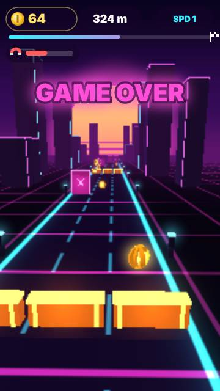
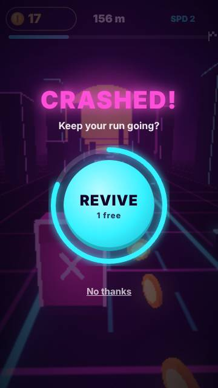
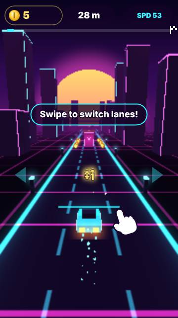

# Friction report — Neon Lanes

The first-time experience is mostly smooth, with clear lane-switching and jump tutorials and a responsive free revive. However, the final GAME OVER screen lacks any buttons or prompts, leaving the player unsure what to do for over two seconds before the end card appears.

| time | type | severity | issue | suggested fix |
| --- | --- | --- | --- | --- |
| 0:24.5–0:26.9 | ui | medium | **GAME OVER screen has no buttons or next-step prompt** — At t=24.5s, after hitting an orange barrier at 324m, the screen displays only 'GAME OVER' over the track with no 'Play Again', 'Continue', or 'Tap to continue' prompt (S2, S6), and the player's input had no visible effect (S4) until the end card appeared 2.4s later (S7). | Add a clear 'Tap to Continue' prompt on the GAME OVER overlay, or transition directly into the end card with the 'PLAY NOW' button after a brief 0.8s pause. |
| 0:13.4 | pacing | low | **Abrupt crash shortly after the jump tutorial** — After successfully jumping the orange barrier and seeing the 'GREAT JUMP!' banner, the player attempted to dodge but hit a pink block late at 156m, triggering the 'CRASHED!' revive popup (S5) while their input had no visible effect (S3). | Add slightly more spacing or a brief 0.5s recovery buffer after the 'GREAT JUMP!' banner before spawning dense pink X-blocks. |
| 0:00.0–0:02.0 | pacing | low | **Slight delay before first swipe registers** — It took 2.0s from the first playable frame for the player's swipe to visibly switch lanes on the 'Swipe to switch lanes!' tutorial screen (S1). | Allow lane-switching input to register immediately from t=0.0s without waiting for the hand-pointer animation to finish its first loop. |

## Evidence

**0:24.5 · GAME OVER screen has no buttons or next-step prompt** (signals S2, S4, S6, S7)

**0:13.4 · Abrupt crash shortly after the jump tutorial** (signals S3, S5)

**0:00.0 · Slight delay before first swipe registers** (signals S1)

## Signals extracted from the session

- `S1` 0:00.0 [time_to_first_success] 2.0 s from the first playable frame until an input visibly worked
- `S2` 0:24.5 [unclear_screen] decider: only 38% that a first-time player knows what to do (screen: fail)
- `S3` 0:13.4 [no_effect] previous input had no visible effect (decider 8%, 44.7% of pixels changed) — the player had tried: 3-lane synthwave runner, 'GREAT JUMP!' banner, car in middle lane, coins ahead
- `S4` 0:24.5 [no_effect] previous input had no visible effect (decider 26%, 44.8% of pixels changed) — the player had tried: 3-lane synthwave runner with MAGNET active, 48 coins, 258m
- `S5` 0:13.4 [fail_screen] a fail / game-over screen
- `S6` 0:24.5 [fail_screen] a fail / game-over screen
- `S7` 0:26.9 [end_card] end card appeared at 26.9 s (session 31.8 s)
