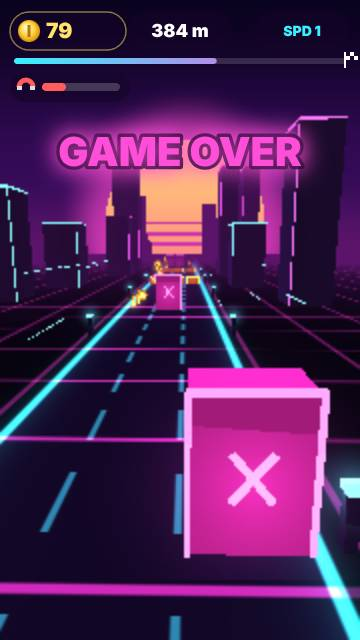
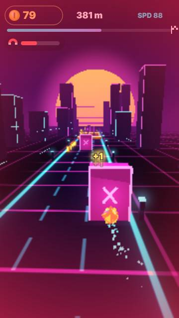

# Friction report — Neon Lanes

The first-time experience is fast and intuitive early on, with clear lane-switching and jump tutorials leading to quick success. However, late-run speed escalation makes obstacles hard to react to, and the final Game Over screen leaves the player with no clear action before the end card appears.

| time | type | severity | issue | suggested fix |
| --- | --- | --- | --- | --- |
| 0:27.2–0:29.2 | ui | high | **Game Over screen lacks any interactive button or transition cue** — After crashing at 384m, the screen displays only 'GAME OVER' floating over the track with no buttons or instructions, causing the player's input to have no effect (19% clarity, 2% input effect) before the end card finally appears 2 seconds later. | Add a brief, clear transition message (e.g., 'Calculating Score...') or immediately display a 'Continue' / 'Play Now' button on the Game Over overlay so players are not left tapping a static screen. |
| 0:25.5–0:27.2 | pacing | medium | **High speed at 381m leaves too little reaction time for obstacles** — At SPD 88, a pink X block appears directly in front of the player's car in the right lane, resulting in an immediate collision and low clarity (46%) on how to avoid it in time. | Cap the maximum speed slightly lower in the playable ad or increase the spawn distance/telegraphing of pink X blocks at speeds above SPD 80. |
| 0:17.0–0:19.2 | frustration | low | **Sudden crash at 227m interrupts flow despite free revive** — The player's input had no visible effect right as they hit an obstacle at 227m, triggering the 'CRASHED! Keep your run going?' popup with a 'REVIVE 1 free' button. | Provide a brief invulnerability flash or slightly more forgiving hitbox on lane transitions so players feel they had a fair chance to dodge before the revive prompt. |
| 0:00.0–0:02.0 | pacing | low | **Smooth initial onboarding with 2.0s to first success** — The 'Swipe to switch lanes!' prompt with directional arrows and hand indicator allowed the player to successfully switch lanes and dodge within 2.0 seconds. | Keep the current tutorial pacing; optionally fade out the hand indicator slightly faster once the player begins swiping. |

## Evidence

**0:27.2 · Game Over screen lacks any interactive button or transition cue** (signals S3, S5, S7, S8)

**0:25.5 · High speed at 381m leaves too little reaction time for obstacles** (signals S2, S5)

**0:17.0 · Sudden crash at 227m interrupts flow despite free revive** (signals S4, S6)

**0:00.0 · Smooth initial onboarding with 2.0s to first success** (signals S1)

## Signals extracted from the session

- `S1` 0:00.0 [time_to_first_success] 2.0 s from the first playable frame until an input visibly worked
- `S2` 0:25.5 [unclear_screen] decider: only 46% that a first-time player knows what to do (screen: gameplay)
- `S3` 0:27.2 [unclear_screen] decider: only 19% that a first-time player knows what to do (screen: fail)
- `S4` 0:17.0 [no_effect] previous input had no visible effect (decider 13%, 42.7% of pixels changed) — the player had tried: 3-lane runner gameplay, car in left lane, 207m, 28 coins
- `S5` 0:27.2 [no_effect] previous input had no visible effect (decider 2%, 66.1% of pixels changed) — the player had tried: 3-lane runner at 381m, SPD 88, pink X block directly in front of player in right
- `S6` 0:17.0 [fail_screen] a fail / game-over screen
- `S7` 0:27.2 [fail_screen] a fail / game-over screen
- `S8` 0:29.2 [end_card] end card appeared at 29.2 s (session 34.1 s)
