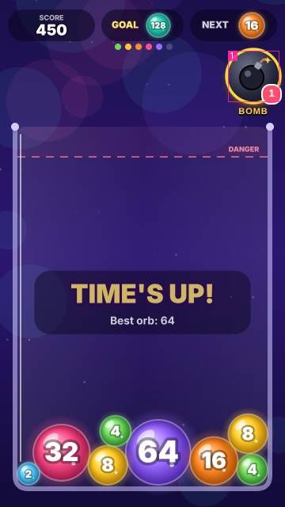
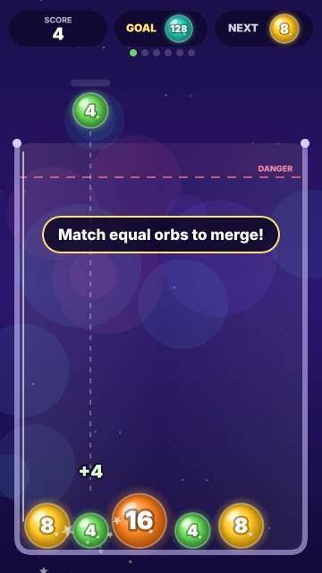
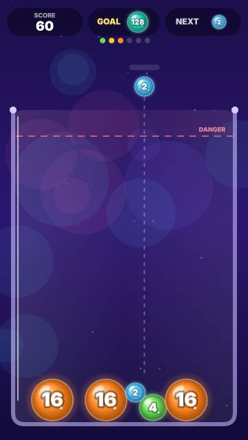

# Friction report — Orb Merge

The player understood the core 2048 orb-drop loop and reached a 64-orb, but experienced a slow 5.4s start and repeated mid-game uncertainty. The biggest friction was an almost-invisible countdown timer that caused an abrupt 'TIME'S UP!' fail screen at 51.0s.

| time | type | severity | issue | suggested fix |
| --- | --- | --- | --- | --- |
| 0:51.0 | ui | high | **Subtle timer leads to abrupt TIME'S UP! fail screen** — The countdown timer is only a thin, unlabeled vertical line along the left wall of the container, so the 'TIME'S UP! Best orb: 64' overlay at 51.0s catches the player off guard (38% clarity on level_end). | Replace or supplement the left-wall bar with a clear numeric countdown badge (e.g., '0:50') in the top HUD that pulses red in the final 10 seconds. |
| 0:00.0–0:05.4 | pacing | medium | **Slow 3.5s idle start and 5.4s to first merge** — The session had 3.5s of no motion or input at the start and took 5.4s to achieve the first visible merge, despite the static 'Drag to aim, release to drop!' prompt and 'Match equal orbs to merge!' banner. | Add an animated dragging hand indicator over the starting 2-orb and a pulsing highlight ring around the matching target orb at the bottom on frame 0. |
| 0:10.9–0:49.0 | confusion | medium | **Mid-game aiming uncertainty and prominent 0-count Bomb UI** — Eleven unclear_screen signals (38%-48% clarity) fired during gameplay; the board lacks a landing-orb ghost preview, and the 'BOMB' button stays large and bright in the top-right even when its counter is '0'. | Dim the 'BOMB' button when its count is 0, and add a subtle pulsing glow to any board orb that matches the currently held orb. |

## Evidence

**0:51.0 · Subtle timer leads to abrupt TIME'S UP! fail screen** (signals S13, S15)

**0:00.0 · Slow 3.5s idle start and 5.4s to first merge** (signals S1, S14)

**0:10.9 · Mid-game aiming uncertainty and prominent 0-count Bomb UI** (signals S2, S3, S4, S5, S6, S7, S8, S9, S10, S11, S12)

## Signals extracted from the session

- `S1` 0:00.0 [time_to_first_success] 5.4 s from the first playable frame until an input visibly worked
- `S2` 0:10.9 [unclear_screen] decider: only 38% that a first-time player knows what to do (screen: gameplay)
- `S3` 0:14.5 [unclear_screen] decider: only 48% that a first-time player knows what to do (screen: gameplay)
- `S4` 0:16.3 [unclear_screen] decider: only 43% that a first-time player knows what to do (screen: gameplay)
- `S5` 0:25.7 [unclear_screen] decider: only 38% that a first-time player knows what to do (screen: gameplay)
- `S6` 0:27.7 [unclear_screen] decider: only 46% that a first-time player knows what to do (screen: gameplay)
- `S7` 0:33.4 [unclear_screen] decider: only 42% that a first-time player knows what to do (screen: gameplay)
- `S8` 0:38.7 [unclear_screen] decider: only 43% that a first-time player knows what to do (screen: gameplay)
- `S9` 0:40.7 [unclear_screen] decider: only 45% that a first-time player knows what to do (screen: gameplay)
- `S10` 0:43.9 [unclear_screen] decider: only 48% that a first-time player knows what to do (screen: gameplay)
- `S11` 0:46.9 [unclear_screen] decider: only 39% that a first-time player knows what to do (screen: gameplay)
- `S12` 0:49.0 [unclear_screen] decider: only 48% that a first-time player knows what to do (screen: gameplay)
- `S13` 0:51.0 [unclear_screen] decider: only 38% that a first-time player knows what to do (screen: level_end)
- `S14` 0:00.0 [idle] 3.5 s with no on-screen motion and no input
- `S15` 0:51.0 [fail_screen] a fail / game-over screen
- `S16` 0:54.0 [end_card] end card appeared at 54.0 s (session 59.2 s)
