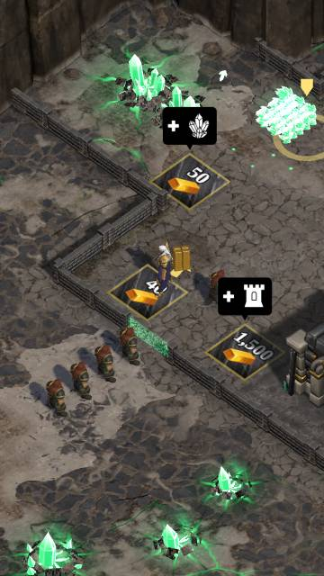
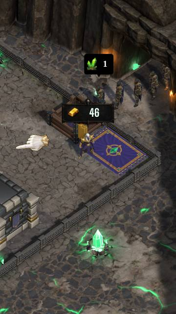
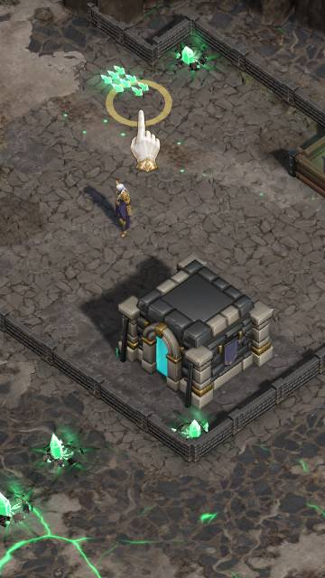

# Friction report — Raid: Shard Market

The first-time player successfully follows the initial shard-gathering loop, but struggles with off-screen tutorial targets, ambiguous upgrade pad icons, and a lack of clear goals once free-roam gameplay begins. Additionally, the playable runs for over 90 seconds without ever presenting an end card or CTA.

| time | type | severity | issue | suggested fix |
| --- | --- | --- | --- | --- |
| 0:40.2–1:28.7 | unclear_goal | high | **Post-tutorial upgrade pads and objectives are ambiguous** — From t=40.2s to 88.7s, clarity drops to 23%–48% as the player navigates between the 40 (pickaxe), 50 (crystal), and 1,500 (tower) pads while a yellow arrow points to the crystal pile. The player steps on pads without clear feedback on whether they can afford them or what the overarching goal is. | Add a persistent top HUD showing current gold, a clear objective tracker (e.g., 'Hire 2 Workers' or 'Unlock the Tower: 49/1500'), and color-code upgrade pad costs (red when unaffordable, green/pulsing when affordable). |
| 1:31.8 | pacing | high | **No end card or CTA within 92 seconds of play** — The session ran for 91.8s and ended by time_limit without ever triggering an end card or install prompt. | Trigger the end card with a clear 'Play Now' CTA after a key milestone—such as hiring the second worker or upgrading the mine (around 45–60s)—rather than waiting for the 1,500-gold tower. |
| 0:22.8–0:34.2 | confusion | medium | **Tutorial hand points off-screen toward hidden upgrade pad** — At t=22.8s, the player is at the golden carpet with 46 gold and the tutorial hand points left-downward into empty courtyard space. The player has to walk around the stone building until t=34.2s before the '10' pickaxe pad becomes visible. | Place an on-screen edge indicator or briefly pan the camera to the '10' pickaxe pad when it becomes the active tutorial step so the player sees their destination immediately. |
| 0:00.5–0:04.5 | ui | medium | **Initial tap input fails to move character or clarify drag control** — At t=0.5s–1.6s, the tutorial hand points to a yellow circle without showing a drag motion, and at t=4.5s the player's input has no visible effect while 'DRAG TO MOVE' is displayed. | Animate the tutorial hand performing a clear drag gesture with a visible virtual joystick ring, and show a subtle joystick indicator on any tap so players immediately understand they need to hold and drag. |

## Evidence

**0:40.2 · Post-tutorial upgrade pads and objectives are ambiguous** (signals S4, S5, S6, S7, S8, S9, S10, S11, S12, S13, S14, S15, S16, S17, S18)

**0:22.8 · Tutorial hand points off-screen toward hidden upgrade pad** (signals S2, S3)

**0:00.5 · Initial tap input fails to move character or clarify drag control** (signals S1, S19)

## Signals extracted from the session

- `S1` 0:00.5 [time_to_first_success] 1.1 s from the first playable frame until an input visibly worked
- `S2` 0:22.8 [unclear_screen] decider: only 37% that a first-time player knows what to do (screen: tutorial)
- `S3` 0:34.2 [unclear_screen] decider: only 50% that a first-time player knows what to do (screen: tutorial)
- `S4` 0:40.2 [unclear_screen] decider: only 35% that a first-time player knows what to do (screen: gameplay)
- `S5` 0:42.8 [unclear_screen] decider: only 31% that a first-time player knows what to do (screen: gameplay)
- `S6` 0:46.6 [unclear_screen] decider: only 45% that a first-time player knows what to do (screen: gameplay)
- `S7` 0:50.3 [unclear_screen] decider: only 30% that a first-time player knows what to do (screen: gameplay)
- `S8` 0:54.4 [unclear_screen] decider: only 43% that a first-time player knows what to do (screen: gameplay)
- `S9` 0:57.5 [unclear_screen] decider: only 23% that a first-time player knows what to do (screen: gameplay)
- `S10` 1:00.5 [unclear_screen] decider: only 37% that a first-time player knows what to do (screen: gameplay)
- `S11` 1:04.9 [unclear_screen] decider: only 36% that a first-time player knows what to do (screen: gameplay)
- `S12` 1:08.7 [unclear_screen] decider: only 48% that a first-time player knows what to do (screen: gameplay)
- `S13` 1:11.7 [unclear_screen] decider: only 36% that a first-time player knows what to do (screen: gameplay)
- `S14` 1:14.6 [unclear_screen] decider: only 34% that a first-time player knows what to do (screen: gameplay)
- `S15` 1:17.6 [unclear_screen] decider: only 32% that a first-time player knows what to do (screen: gameplay)
- `S16` 1:21.7 [unclear_screen] decider: only 28% that a first-time player knows what to do (screen: gameplay)
- `S17` 1:25.6 [unclear_screen] decider: only 25% that a first-time player knows what to do (screen: gameplay)
- `S18` 1:28.7 [unclear_screen] decider: only 29% that a first-time player knows what to do (screen: gameplay)
- `S19` 0:04.5 [no_effect] previous input had no visible effect (decider 30%, 51.7% of pixels changed) — the player had tried: Isometric dungeon/courtyard with character, building, green crystals, and tutori
- `S20` 1:31.8 [no_end_card] no end card within 92 s of play
