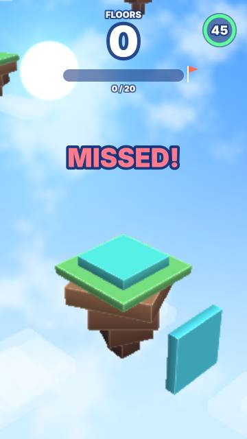
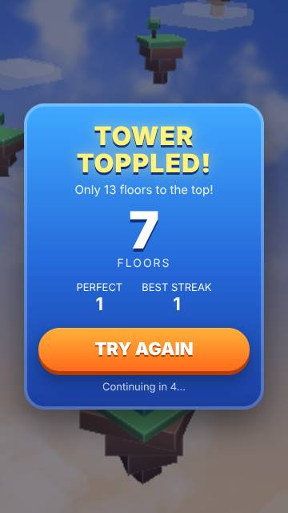
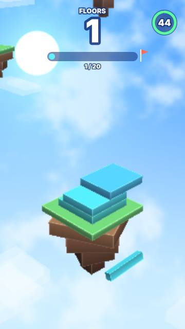
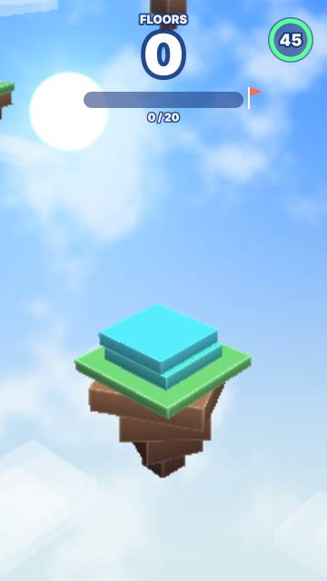

# Friction report — Sky Stack

The player understood the core tap-to-drop mechanic and reached 7/20 floors on their first run, but experienced confusion during the unresponsive 'MISSED!' transition and failed at 0 floors on their second attempt. Tightening the fail-state transition, speeding up the opening, and adding early-game forgiveness would make the first-time experience smoother.

| time | type | severity | issue | suggested fix |
| --- | --- | --- | --- | --- |
| 0:13.7–0:21.6 | confusion | high | **Unresponsive screen and missing HUD during miss transition** — After missing a drop at t=13.7s (S6) and t=19.2s (S4, S7), 'MISSED!' appeared while the block fell, and at t=20.3s (S5, S8) the HUD disappeared with no moving block visible. Taps during this window had no visible effect and triggered unclear_screen signals (27-39% confidence). | Transition directly into the 'Tower Toppled' fail overlay as soon as a miss is registered, rather than leaving the player on a HUD-less tower screen where taps do nothing. |
| 0:15.3–0:23.0 | frustration | medium | **Instant fail on a single miss, including at 0 floors** — A single miss ended the first run at 7/20 floors (S9), and a miss on the very first block ended the second run at 0 floors (S10), immediately pushing the player to the end card at t=23.0s (S12). | Add a 1-miss grace/shield on the first few floors (or widen the initial block tolerance) so a single early mistap does not immediately end the run at 0 floors. |
| 0:00.0–0:04.4 | pacing | medium | **Slow time to first successful drop** — It took 4.4s from the first playable frame until the player's first tap visibly stacked a block (S1), with the tutorial prompt still active at t=2.0s. | Have the first block already sliding in on frame 1 with a pulsing tap indicator, and dismiss the tutorial prompt on the first tap so the player scores their first floor within 1-2 seconds. |
| 0:17.4 | ui | low | **No sliding block visible immediately after restart** — Right after restarting at t=17.4s (S3), the screen showed 0/20 floors and 45s on the timer, but no sliding block was visible yet, causing an unclear_screen signal (36% confidence). | Spawn the first sliding block already visible at the edge of the play area immediately upon tapping 'TRY AGAIN' so the player sees the round is active. |

## Evidence

**0:13.7 · Unresponsive screen and missing HUD during miss transition** (signals S4, S5, S6, S7, S8)

**0:15.3 · Instant fail on a single miss, including at 0 floors** (signals S9, S10, S12)

**0:00.0 · Slow time to first successful drop** (signals S1)

**0:17.4 · No sliding block visible immediately after restart** (signals S3)

## Signals extracted from the session

- `S1` 0:00.0 [time_to_first_success] 4.4 s from the first playable frame until an input visibly worked
- `S2` 0:12.2 [unclear_screen] decider: only 45% that a first-time player knows what to do (screen: gameplay)
- `S3` 0:17.4 [unclear_screen] decider: only 36% that a first-time player knows what to do (screen: gameplay)
- `S4` 0:19.2 [unclear_screen] decider: only 39% that a first-time player knows what to do (screen: gameplay)
- `S5` 0:20.3 [unclear_screen] decider: only 27% that a first-time player knows what to do (screen: gameplay)
- `S6` 0:13.7 [no_effect] previous input had no visible effect (decider 19%, 5.6% of pixels changed) — the player had tried: Stack gameplay at 7/20 floors, 36s remaining
- `S7` 0:19.2 [no_effect] previous input had no visible effect (decider 3%, 14.5% of pixels changed) — the player had tried: Fresh game started, 0/20 floors, 45s timer, first block sliding in from left
- `S8` 0:21.6 [no_effect] previous input had no visible effect (decider 3%, 96.5% of pixels changed) — the player had tried: Cyan block stacked on green platform, no moving block visible yet
- `S9` 0:15.3 [fail_screen] a fail / game-over screen
- `S10` 0:21.6 [fail_screen] a fail / game-over screen
- `S11` 0:05.0 [slips] 1 imprecise tap(s) by the player (targets may be small)
- `S12` 0:23.0 [end_card] end card appeared at 23.0 s (session 29.0 s)
