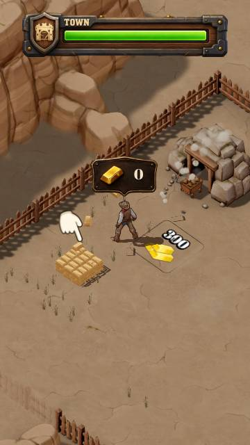
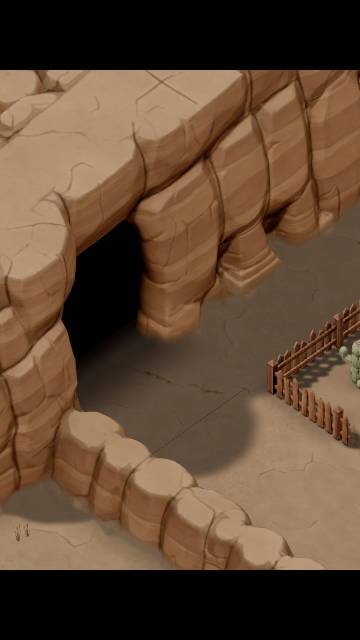
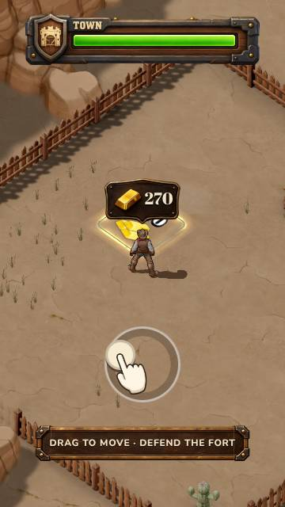

# Friction report — Wild West

The first-time experience is hampered by persistent visual ambiguity, with the player frequently unsure whether to fight outlaws, collect gold, or step onto competing build pads. Additionally, unskippable camera pans lock out controls mid-session, and the playable runs for 93 seconds without ever presenting an end card.

| time | type | severity | issue | suggested fix |
| --- | --- | --- | --- | --- |
| 0:18.5–1:28.5 | unclear_goal | high | **Competing objectives and unclear pad priorities** — From t=18.5s onward, clarity scores stay between 22% and 49%. At t=18.5s, a tutorial hand points to a gold pile down-left while a 300-gold pad sits right next to the cowboy (with 0 gold). Later, during active waves at the left fence (t=37.2s-77.5s), hint hands repeatedly point to the minecart or hay bale on the right while multiple pads (200, 300, 1,050) compete for attention. | Dim or hide non-affordable build pads, and show only one contextual objective arrow at a time (e.g., point to gold only when below the next pad's cost, or point to the fence when outlaws are attacking). |
| 0:24.5–0:30.5 | stuck | high | **Camera pan cutscene locks out input without context** — At t=24.5s, the camera pans to a cave entrance with all UI hidden, causing the player's previous input to have no effect and dropping clarity to 15%-19% until control returns at t=30.5s. A similar camera pan occurs during building construction at t=63.9s-66.9s while enemies attack the fence. | Keep the Town HP bar and a subtle 'INCOMING WAVE' banner visible during the cave pan, shorten the cutscene to under 2 seconds, and avoid panning the camera away from active combat during construction animations. |
| 0:00.5–0:08.0 | pacing | medium | **Slow onboarding and stalled initial pad interaction** — The session starts with 3.0s of no motion or input and takes 5.0s for an input to visibly work. By t=8.0s, the cowboy is standing on the 270-gold spot with the tutorial hand still on the joystick, and waiting produces no visible change (0.1% pixel change). | Trigger an immediate, brief pulse on the joystick and gold pad at t=0.5s, and auto-collect or clearly animate the gold transfer as soon as the cowboy steps onto the starting 270-gold pad. |
| 1:32.6 | pacing | medium | **No end card shown within 93 seconds** — The playable ran until the 92.6s time limit without ever displaying an end card or install CTA. | Trigger the end card and install CTA after the first major wave is cleared or the saloon/deputies building finishes around t=65s, rather than letting the session time out. |

## Evidence

**0:18.5 · Competing objectives and unclear pad priorities** (signals S2, S3, S7, S8, S9, S10, S11, S12, S13, S14, S15, S18, S19, S20, S21, S22, S23)

**0:24.5 · Camera pan cutscene locks out input without context** (signals S4, S5, S6, S16, S17, S25)

**0:00.5 · Slow onboarding and stalled initial pad interaction** (signals S1, S24, S26)

## Signals extracted from the session

- `S1` 0:00.5 [time_to_first_success] 5.0 s from the first playable frame until an input visibly worked
- `S2` 0:18.5 [unclear_screen] decider: only 41% that a first-time player knows what to do (screen: tutorial)
- `S3` 0:21.5 [unclear_screen] decider: only 46% that a first-time player knows what to do (screen: gameplay)
- `S4` 0:24.5 [unclear_screen] decider: only 15% that a first-time player knows what to do (screen: gameplay)
- `S5` 0:27.0 [unclear_screen] decider: only 18% that a first-time player knows what to do (screen: gameplay)
- `S6` 0:30.5 [unclear_screen] decider: only 19% that a first-time player knows what to do (screen: gameplay)
- `S7` 0:37.2 [unclear_screen] decider: only 29% that a first-time player knows what to do (screen: gameplay)
- `S8` 0:38.9 [unclear_screen] decider: only 37% that a first-time player knows what to do (screen: gameplay)
- `S9` 0:42.6 [unclear_screen] decider: only 48% that a first-time player knows what to do (screen: gameplay)
- `S10` 0:46.3 [unclear_screen] decider: only 38% that a first-time player knows what to do (screen: gameplay)
- `S11` 0:48.8 [unclear_screen] decider: only 43% that a first-time player knows what to do (screen: gameplay)
- `S12` 0:52.4 [unclear_screen] decider: only 36% that a first-time player knows what to do (screen: gameplay)
- `S13` 0:55.5 [unclear_screen] decider: only 22% that a first-time player knows what to do (screen: gameplay)
- `S14` 0:58.8 [unclear_screen] decider: only 22% that a first-time player knows what to do (screen: gameplay)
- `S15` 1:01.9 [unclear_screen] decider: only 42% that a first-time player knows what to do (screen: gameplay)
- `S16` 1:03.9 [unclear_screen] decider: only 26% that a first-time player knows what to do (screen: gameplay)
- `S17` 1:06.9 [unclear_screen] decider: only 18% that a first-time player knows what to do (screen: gameplay)
- `S18` 1:09.9 [unclear_screen] decider: only 44% that a first-time player knows what to do (screen: gameplay)
- `S19` 1:13.7 [unclear_screen] decider: only 39% that a first-time player knows what to do (screen: gameplay)
- `S20` 1:17.5 [unclear_screen] decider: only 30% that a first-time player knows what to do (screen: gameplay)
- `S21` 1:21.3 [unclear_screen] decider: only 47% that a first-time player knows what to do (screen: gameplay)
- `S22` 1:25.2 [unclear_screen] decider: only 49% that a first-time player knows what to do (screen: gameplay)
- `S23` 1:28.5 [unclear_screen] decider: only 46% that a first-time player knows what to do (screen: gameplay)
- `S24` 0:08.0 [no_effect] previous input had no visible effect (decider 11%, 0.1% of pixels changed) — the player had tried: Cowboy standing on glowing gold spot showing 270 gold
- `S25` 0:24.5 [no_effect] previous input had no visible effect (decider 15%, 78.3% of pixels changed) — the player had tried: Cowboy has 66 gold, standing by the gold mine and a 300-gold pad.
- `S26` 0:00.5 [idle] 3.0 s with no on-screen motion and no input
- `S27` 1:32.6 [no_end_card] no end card within 93 s of play
