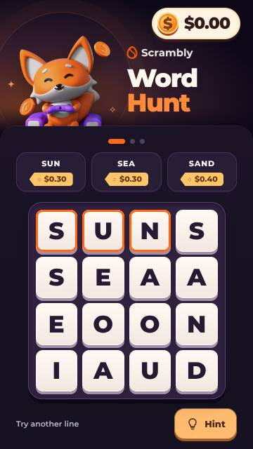

# Friction report — Word Hunt · Scrambly

The player repeatedly got stuck with no visible feedback on the 4x4 word grid, failing to complete even the tutorial word 'SUN' within 45.7 seconds. The session ended by time limit without ever reaching an end card or conversion CTA.

| time | type | severity | issue | suggested fix |
| --- | --- | --- | --- | --- |
| 0:05.2–0:06.9 | stuck | high | **Repeated inputs produce no visible effect on the grid** — Across S2-S5 (t=5.2-6.9s), three consecutive inputs resulted in 0.0% pixel change while the bottom-left text remained 'Try another line' and the balance stayed at $0.00. Similar multi-turn stuck states recurred at S8, S13, S17, S20, S26, and S30. | Add immediate visual feedback for invalid or incomplete swipes—such as a brief tile shake, a fading orange line trail, or highlighting valid adjacent letters—so players understand why their input did not register. |
| 0:02.6–0:09.8 | confusion | high | **Static tutorial highlight does not clearly demonstrate the swipe gesture** — At t=2.6s (S1), 'S', 'U', and 'N' are outlined in orange with small 'Swipe to connect' text at the bottom left, and by t=9.8s (S6) only a single 'S' is highlighted with 'Choose the last letter' while inputs still fail to progress. | Replace the static orange outline on S-U-N with an animated finger/hand icon and glowing swipe path moving from S to U to N until the first word is completed. |
| 0:45.7 | pacing | medium | **No end card shown within 46 seconds of play** — The session ran for 45.7 seconds and ended by time_limit without displaying an end card or install CTA (S31). | Add a fallback timer (e.g., 25-30 seconds) or a 'Claim / Download' CTA that triggers the end card even if the player has not cleared the first word board. |

## Evidence

**0:05.2 · Repeated inputs produce no visible effect on the grid** (signals S2, S3, S4, S5, S8, S13, S17, S20, S26, S30)

**0:02.6 · Static tutorial highlight does not clearly demonstrate the swipe gesture** (signals S1, S6, S7)

## Signals extracted from the session

- `S1` 0:02.6 [no_effect] previous input had no visible effect (decider n/a, 0.0% of pixels changed) — the player had tried: (random policy)
- `S2` 0:05.2 [no_effect] previous input had no visible effect (decider n/a, 0.0% of pixels changed) — the player had tried: (random policy)
- `S3` 0:06.0 [no_effect] previous input had no visible effect (decider n/a, 0.0% of pixels changed) — the player had tried: (random policy)
- `S4` 0:06.9 [no_effect] previous input had no visible effect (decider n/a, 0.0% of pixels changed) — the player had tried: (random policy)
- `S5` 0:05.2 [stuck] 3 consecutive turns where the player's input had no visible effect
- `S6` 0:09.8 [no_effect] previous input had no visible effect (decider n/a, 0.0% of pixels changed) — the player had tried: (random policy)
- `S7` 0:10.2 [no_effect] previous input had no visible effect (decider n/a, 0.0% of pixels changed) — the player had tried: (random policy)
- `S8` 0:09.8 [stuck] 2 consecutive turns where the player's input had no visible effect
- `S9` 0:13.1 [no_effect] previous input had no visible effect (decider n/a, 0.0% of pixels changed) — the player had tried: (random policy)
- `S10` 0:14.2 [no_effect] previous input had no visible effect (decider n/a, 0.0% of pixels changed) — the player had tried: (random policy)
- `S11` 0:16.2 [no_effect] previous input had no visible effect (decider n/a, 0.0% of pixels changed) — the player had tried: (random policy)
- `S12` 0:17.1 [no_effect] previous input had no visible effect (decider n/a, 0.0% of pixels changed) — the player had tried: (random policy)
- `S13` 0:16.2 [stuck] 2 consecutive turns where the player's input had no visible effect
- `S14` 0:19.5 [no_effect] previous input had no visible effect (decider n/a, 0.0% of pixels changed) — the player had tried: (random policy)
- `S15` 0:21.8 [no_effect] previous input had no visible effect (decider n/a, 0.0% of pixels changed) — the player had tried: (random policy)
- `S16` 0:22.7 [no_effect] previous input had no visible effect (decider n/a, 0.0% of pixels changed) — the player had tried: (random policy)
- `S17` 0:21.8 [stuck] 2 consecutive turns where the player's input had no visible effect
- `S18` 0:28.9 [no_effect] previous input had no visible effect (decider n/a, 0.0% of pixels changed) — the player had tried: (random policy)
- `S19` 0:29.3 [no_effect] previous input had no visible effect (decider n/a, 0.0% of pixels changed) — the player had tried: (random policy)
- `S20` 0:28.9 [stuck] 2 consecutive turns where the player's input had no visible effect
- `S21` 0:31.1 [no_effect] previous input had no visible effect (decider n/a, 0.0% of pixels changed) — the player had tried: (random policy)
- `S22` 0:34.2 [no_effect] previous input had no visible effect (decider n/a, 0.0% of pixels changed) — the player had tried: (random policy)
- `S23` 0:37.9 [no_effect] previous input had no visible effect (decider n/a, 0.0% of pixels changed) — the player had tried: (random policy)
- `S24` 0:39.9 [no_effect] previous input had no visible effect (decider n/a, 0.0% of pixels changed) — the player had tried: (random policy)
- `S25` 0:40.9 [no_effect] previous input had no visible effect (decider n/a, 0.0% of pixels changed) — the player had tried: (random policy)
- `S26` 0:39.9 [stuck] 2 consecutive turns where the player's input had no visible effect
- `S27` 0:43.2 [no_effect] previous input had no visible effect (decider n/a, 0.0% of pixels changed) — the player had tried: (random policy)
- `S28` 0:43.7 [no_effect] previous input had no visible effect (decider n/a, 0.0% of pixels changed) — the player had tried: (random policy)
- `S29` 0:44.5 [no_effect] previous input had no visible effect (decider n/a, 0.0% of pixels changed) — the player had tried: (random policy)
- `S30` 0:43.2 [stuck] 3 consecutive turns where the player's input had no visible effect
- `S31` 0:45.7 [no_end_card] no end card within 46 s of play
