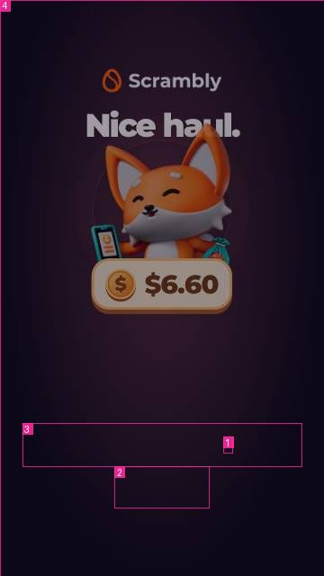
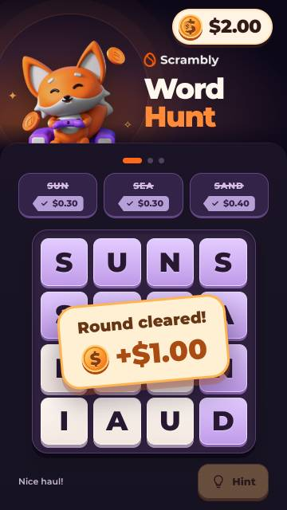

# Friction report — Word Hunt (Scrambly)

The player smoothly completed all three rounds of Word Hunt and reached the end card in 20.7 seconds, but experienced an initial 3.5-second idle period and a slow 7.1-second time-to-first-success. On the end card, the call-to-action buttons were not visibly rendered, leaving the player with no clear next step.

| time | type | severity | issue | suggested fix |
| --- | --- | --- | --- | --- |
| 0:20.7–0:26.2 | ui | high | **End card CTA buttons are invisible** — At t=20.7s on the end card, the 'Nice haul.' header and '$6.60' badge are visible, but the 'Play on Scrambly' and 'Play again' buttons are completely dark/unrendered, resulting in only 36% confidence that a first-time player knows what to do. | Remove any delayed fade-in on the end card buttons and render 'Play on Scrambly' with a high-contrast primary button style immediately when the end card appears at t=20.7s. |
| 0:00.0–0:07.1 | pacing | medium | **Slow start with 3.5s initial idle** — From t=0.0s to 3.5s there was no on-screen motion or input, and it took 7.1s from the first playable frame until an input visibly worked. | Display an animated hand-swipe tutorial over the first target word ('SUN') on the 4x4 grid immediately at t=0.0s to prompt the player's first swipe. |
| 0:08.0–0:11.0 | pacing | low | **3.0s idle gap between Round 1 and Round 2** — After clearing Round 1 at t=7.1s with the '+$1.00' banner, there was a 3.0-second period (t=8.0-11.0s) with no on-screen motion or input before Round 2 gameplay began. | Shorten the 'Round cleared! +$1.00' banner duration and transition directly into the 5x5 Round 2 grid within 1.0 to 1.5 seconds. |

## Evidence

**0:20.7 · End card CTA buttons are invisible** (signals S2, S5)

**0:00.0 · Slow start with 3.5s initial idle** (signals S1, S3)

## Signals extracted from the session

- `S1` 0:00.0 [time_to_first_success] 7.1 s from the first playable frame until an input visibly worked
- `S2` 0:20.7 [unclear_screen] decider: only 36% that a first-time player knows what to do (screen: end_card)
- `S3` 0:00.0 [idle] 3.5 s with no on-screen motion and no input
- `S4` 0:08.0 [idle] 3.0 s with no on-screen motion and no input
- `S5` 0:20.7 [end_card] end card appeared at 20.7 s (session 26.2 s)
